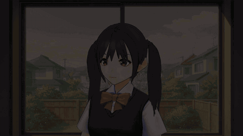

# Metamorphosis: a HairDeck demo

[](https://az9713.github.io/claude-duet-coding-demo/)

**[Play the full film with music (90 s)](https://az9713.github.io/claude-duet-coding-demo/)**

The image above is a silent 13 s preview at 7 times speed. Select it to open the player page, because a GitHub README cannot run a video player from a Pages site.

Metamorphosis is an animated short film with music and no dialogue: one woman's life told by her hair alone, in one unbroken shot at a window. The view through the window changes through the decades.

**Her face does not age. This is deliberate.** Only the hair, the light, and the window view carry the time, so the attention stays on what HairDeck makes.

The film is the second test of [HairDeck](https://github.com/hyz317/HairDeck), which makes animation-ready hair cards from a single image. The first was [Regrowth](https://github.com/az9713/hairdeck-demo), which cut and removed the cards. Metamorphosis changes each hairstyle into the next **in the latent space of HairDeck's card VAE**.

## How this project started

This project started in **Claude Duet, in Voice mode**, while the developer was taking a walk in the park. After the first HairDeck demo, [Regrowth](https://github.com/az9713/hairdeck-demo), the developer asked Claude Duet to come up with a second, creative HairDeck demo. Claude Duet proposed the latent-morph technique and the "one life told by hair alone" story, and sent the brief to Claude Code by voice. Claude Code built the film, with two review checkpoints for the developer: the style images and a 10-second morph test.

**[Making of Metamorphosis](https://az9713.github.io/claude-duet-coding-demo/making-of.html)** tells how Claude Duet and Claude Code worked together: the voice brief word for word, who did what, the timeline, the build, the problems and fixes, and the cost.

## Timeline

| Time | Hair | Action | Window |
|---|---|---|---|
| 0-13 s | Two pigtails, red ribbons | An arm from off-screen ties the ribbon on her left pigtail | Spring, a young cherry tree |
| 13-19 s | Morph | | |
| 19-27 s | High ponytail | She turns her head, and the ponytail swings | Summer |
| 27-33 s | Morph | | |
| 33-40 s | Wedding updo | She smiles and tilts her head | Cherry blossom, ribbons on the fence |
| 40-46 s | Morph | | |
| 46-54 s | Short bob, one side tucked | Tired, she pushes her hair back | Rainy autumn evening |
| 54-64 s | Morph (10 s) | The colour drains to silver, strand by strand, and the hair grows long | |
| 64-70 s | Long, loose, silver | | Winter, the old tree in snow |
| 70-76 s | Morph | | |
| 76-90 s | Silver side lock | A grandchild steps in and works on the lock. The camera ends on the child, in the same pigtails as the girl at the start | The old tree in full bloom |

## How it was made

1. Generate one reference image with `fal-ai/nano-banana`, then 5 more hairstyles as edits of it with `fal-ai/nano-banana/edit`, so the face stays the same (`assets/styles/`).
2. Run the images through the [HairDeck Space](https://huggingface.co/spaces/hyz317/HairDeck), 4 seeds per style, and pick one seed per style (`tools/space_generate.py`, `tools/card_sheet.py`). The picked cards and spring chains are in `assets/final/`. Two tendril cards of the updo are removed, because they crossed her face.
3. Morph each style into the next with HairDeck's card VAE (`tools/morph.py`):
   - Encode every card into the 64-dimensional latent space.
   - Pair the cards of two styles with the Hungarian method. The cost is the latent distance plus the root distance, each divided by its median.
   - The cost matrix has extra "dissolve" and "spawn" entries. A style with more cards grows new cards from their roots, and a style with fewer cards shrinks cards back into their roots.
   - Per frame, blend each pair's latent and root, decode, and resample every card to 48 points, so one mesh with a fixed topology holds the whole morph.
   - Each card starts at its own random time in the first 45% of the morph. Card colours from HairDeck's colour model blend in CIE Lab.
4. Move the cards onto the avatar (`rig.py`, `blender/scene.py`), and keep long front locks on her chest.
5. Simulate HairDeck's spring chains at 90 Hz with sphere colliders (`blender/film.py`). During a morph, the chains of both styles are simulated, and their deformations are blended with the same weight as the latents.
6. Animate the hands with Blender IK: the off-screen arm is the right arm of a second avatar, and the grandchild is a third avatar with the first style's pigtails fitted to her head.
7. Paint one window in 6 periods with fal for the backdrop (`assets/plates/`).
8. Render 2,700 frames at 1920x1080 with EEVEE, at about 1.03 s per frame on a laptop GPU (RTX 3050, 4 GB).
9. Edit a `fal-ai/minimax-music/v2.6` track to 90 s, add the title and credit, and encode the film (`tools/finish.py`).

The fal jobs cost $0.71 by list price: 14 images at $0.0398 each and 1 music track at $0.15.

### The five morphs

| Morph | Cards | Pairs | Dissolve | Spawn |
|---|---|---|---|---|
| Pigtails to ponytail | 76 to 72 | 72 | 4 | 0 |
| Ponytail to updo | 72 to 66 | 64 | 8 | 2 |
| Updo to bob | 66 to 81 | 66 | 0 | 15 |
| Bob to long silver | 81 to 59 | 58 | 23 | 1 |
| Long silver to side lock | 59 to 100 | 59 | 0 | 41 |

HairDeck puts almost all card roots in a small area at the crown (for the bob, the roots span only ±0.003 in x). So the shape of each card, relative to its root, carries most of the style, and the latent distance decides most pairs.

## What is in this repo

- `docs/`: the player page, the film, and the making-of page, served by GitHub Pages.
- `blender/film.py`: the whole film (performance, spring simulation, morph playback, hands, grandchild, backdrops, render loop).
- `blender/scene.py`, `rig.py`: the avatar scene and the hair placement. `blender/t_fit.py` and `blender/t_chest.py` measure the head fit and the chest profile that `rig.py` uses.
- `blender/morph_render.py`: the 10-second morph test and the views of the picked styles.
- `tools/`: HairDeck Space client, contact sheets, the latent morph, and the final edit.
- `assets/`: avatars, reference images, HairDeck results, backdrops, and the music track.

**A clean clone can render the film, with two downloads.** `tools/morph.py` and `rig.py` need a [HairDeck](https://github.com/hyz317/HairDeck) clone in `HairDeck/` and the card VAE checkpoint in `hd_ws/ckpt/card_vae/` (from Hugging Face `hyz317/HairDeck`). Set the `FFMPEG` environment variable, or install `imageio-ffmpeg`. The commands are:

```
python -I tools/morph.py assets/final/s1_b.json assets/final/s2.json out/final/m_s1_b_s2.npz 180
python -I tools/morph.py assets/final/s2.json assets/final/s3_a.json out/final/m_s2_s3_a.npz 180
python -I tools/morph.py assets/final/s3_a.json assets/final/s4.json out/final/m_s3_a_s4.npz 180
python -I tools/morph.py assets/final/s4.json assets/final/s5.json out/final/m_s4_s5.npz 300
python -I tools/morph.py assets/final/s5.json assets/final/s6.json out/final/m_s5_s6.npz 180
blender -b --factory-startup -P blender/film.py -- render 0 2700 1920
python -I tools/finish.py
```

## Known limits

- **No real braid:** HairDeck made the last style as a loose side lock with a thin twisted tail, not a braid. The video in References also reports braids as a HairDeck failure case. The grandchild's hands move at the lock; the lock does not braid.
- **Hands do not touch the hair:** the hands move to points near the hair, and the cards do not react to the fingers.
- **Off-screen arm:** only the vertices weighted to the right-arm bones of AvatarSample_F are kept. Its cut shoulder end stays outside the frame only at the planned camera positions.
- **Card penetration:** midway through a morph, a few blended cards can pass through the head or through each other. The colliders are spheres (skull, chest, shoulders).
- **Avatar fit:** HairDeck places hair for its own avatar. `rig.to_woman` maps it onto Base_Female with one scale (1.0035) and a shift, from the skullcap bounds (size ratios per axis 1.014, 1.003, 0.994). The child's hair uses a scale of 0.913.
- **Lighting:** the toon shader takes its colour from the textures, so the sun colour does not tint her. The time of day comes from the backdrops and a small exposure change.
- **Not built:** an interactive player page for the latent morph.

## Avatars and licences

- **Avatars:** Base_Female (the woman), AvatarSample_E (the grandchild), and AvatarSample_F (the off-screen arm), from [VRoid Studio CC0 models](https://opengameart.org/content/vroid-studio-cc0-models) on OpenGameArt (page licence CC0). The VRM metadata of all three allows redistribution, modification, and commercial use, with no credit needed. They are in `assets/avatar_src/`.
- **AI-generated content:** the backdrops, reference images, and music were generated with AI through fal. The code and film were made with Claude Code.
- **This repo:** it has no licence file. HairDeck has its own licence (Apache-2.0).

## References

- **Video:** [Finally AI Can Make Anime Hair Cards - Free and Local](https://www.youtube.com/watch?v=c2ZsNhlYftM), by Stefan 3D AI. It tests HairDeck and reports the cleanup that its output needs. This film is not connected with that channel.
- **Code:** [hyz317/HairDeck](https://github.com/hyz317/HairDeck).
- **Paper:** [HairDeck: Animation-Ready Stylized Hair Cards from a Single Image](https://arxiv.org/abs/2610.40599).
